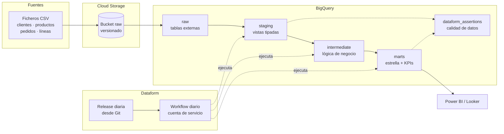
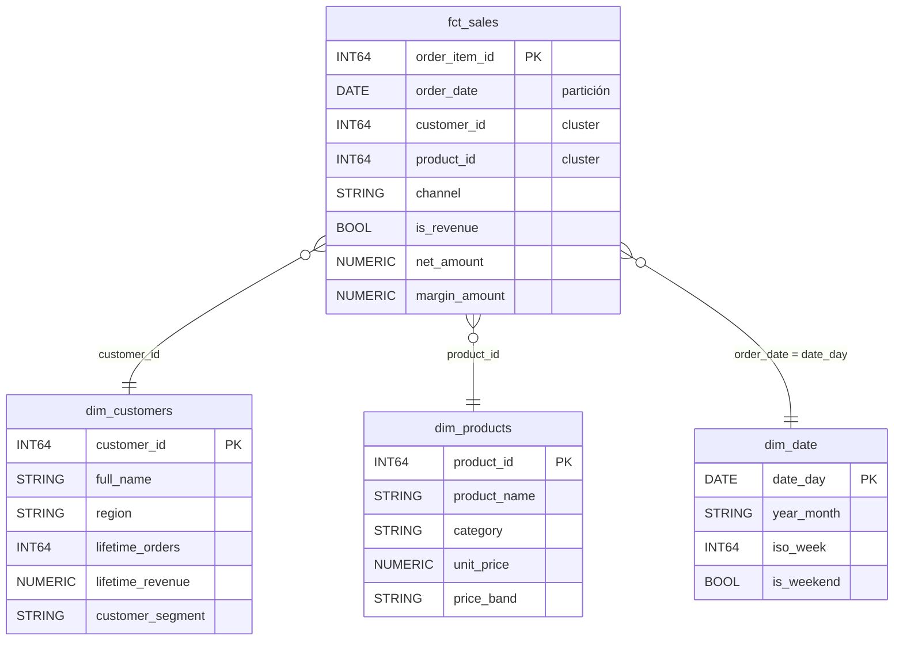

# GCP Data Pipeline · Dataform + Terraform

[](https://github.com/adonaismarrero/gcp-dataform-terraform-pipeline/actions/workflows/ci.yml)


Pipeline analítico de referencia en **Google Cloud**: los ficheros llegan a un bucket de
Cloud Storage, **Dataform** los transforma en BigQuery por capas (staging → intermediate →
marts) hasta un **modelo en estrella** listo para Power BI o Looker, y **Terraform** despliega
toda la infraestructura con permisos mínimos y ejecución programada.

El caso de uso es una **tienda online ficticia**: los datos son sintéticos y se generan con un
script reproducible.

> **English summary** — Reference analytics pipeline on GCP. Raw CSV files land in Cloud
> Storage, Dataform builds a layered BigQuery model (staging → intermediate → marts, star
> schema with an incremental fact table and data-quality assertions) and Terraform provisions
> everything: datasets, external tables, least-privilege service account, Dataform repository,
> scheduled release and daily workflow. CI validates Terraform, compiles Dataform and checks
> that the synthetic dataset is reproducible.

---

## Arquitectura



| Capa | Dataset | Tipo | Qué hace |
|---|---|---|---|
| **raw** | `raw` | Tablas externas (Terraform) | Lee los CSV directamente del bucket. Todo `STRING`: un valor erróneo nunca rompe la carga. |
| **staging** | `staging` | Vistas | Una por tabla origen: tipado con `SAFE_CAST`, limpieza de texto, deduplicación (última versión de cada cliente). |
| **intermediate** | `intermediate` | Vistas | Joins reutilizables: líneas de pedido + cabecera + producto, coste, margen y reparto del envío. |
| **marts** | `marts` | Tablas | Modelo en estrella: `fct_sales` (incremental), `dim_customers`, `dim_products`, `dim_date` y `agg_sales_monthly`. |

## Modelo de datos (marts)



- **`fct_sales`** es **incremental** (`MERGE` por `order_item_id`), **particionada por día** y
  **clusterizada** por cliente y producto: cada ejecución solo reprocesa los últimos días
  (ventana configurable para datos que llegan tarde).
- **`agg_sales_monthly`** deja los KPIs mensuales precalculados (pedidos, clientes, unidades,
  ingresos, margen, ticket medio) por categoría y canal.

## Calidad de datos

Cada modelo declara sus comprobaciones y Dataform las ejecuta como *assertions* tras construirlo:

| Comprobación | Dónde |
|---|---|
| Clave única y no nula | todos los modelos (`uniqueKey`, `nonNull`) |
| Valores permitidos (estado del pedido), importes ≥ 0, descuento entre 0 y 1 | staging (`rowConditions`) |
| Integridad referencial: ninguna línea sin pedido o sin producto | `assert_no_orphan_order_items` |
| Conciliación: el total de `fct_sales` cuadra con staging | `assert_sales_reconcile` |

## Infraestructura (Terraform)

| Recurso | Detalle |
|---|---|
| APIs | BigQuery, Dataform, IAM, Secret Manager, Cloud Storage |
| Bucket raw | Versionado, acceso uniforme, acceso público bloqueado, retiene 3 versiones |
| Datasets BigQuery | Uno por capa, con etiquetas; en `prod` no se borran con su contenido |
| Tablas externas | Una por fichero origen, esquema generado desde `locals.tf` |
| Cuenta de servicio | `dataform-runner` con solo `bigquery.dataEditor`, `bigquery.jobUser` y lectura del bucket |
| Repositorio Dataform | Enlazado a Git (opcional); el token vive en **Secret Manager**, nunca en el estado de Terraform |
| Programación | *Release* diaria que compila la rama `main` + *workflow* diario que ejecuta todo el grafo |

Se recomienda **un proyecto de GCP por entorno** (`dev`, `prod`); el estado remoto va en un
bucket GCS (configuración parcial del *backend*).

## Puesta en marcha

Requisitos: `gcloud`, Terraform ≥ 1.6 y un proyecto de GCP con facturación.

```bash
# 1. (Opcional) regenerar los datos sintéticos
python scripts/generate_data.py                # --orders 20000 para más volumen

# 2. Infraestructura
cd terraform
cp environments/dev.tfvars.example environments/dev.tfvars              # edita project_id
cp environments/dev.gcs.tfbackend.example environments/dev.gcs.tfbackend
terraform init -backend-config=environments/dev.gcs.tfbackend
terraform apply -var-file=environments/dev.tfvars

# 3. Transformaciones (CLI de Dataform)
cd ../dataform
npm install -g @dataform/cli@3.0.0
dataform init-creds        # credenciales de BigQuery para la CLI
dataform run               # construye todo el grafo y ejecuta las assertions
```

Para la ejecución programada en GCP, indica `git_remote_url` en el `.tfvars`, añade el token
de Git al secreto creado y vuelve a aplicar:

```bash
echo -n "<token>" | gcloud secrets versions add dataform-git-token --data-file=-
```

## Estructura

```
.
├── data/raw/                 # CSV sintéticos (generados por scripts/generate_data.py)
├── dataform/
│   ├── workflow_settings.yaml
│   ├── includes/constants.js # constantes y helpers SQL compartidos
│   └── definitions/
│       ├── sources/          # declaración de las tablas raw
│       ├── staging/          # stg_*  (vistas)
│       ├── intermediate/     # int_*  (vistas)
│       ├── marts/            # fct_*, dim_*, agg_*  (tablas)
│       └── assertions/       # comprobaciones de calidad
├── terraform/                # infraestructura + environments/*.example
├── scripts/generate_data.py  # generador de datos (solo librería estándar)
└── .github/workflows/ci.yml  # fmt + validate, dataform compile, datos reproducibles
```

## Decisiones de diseño

- **Raw como `STRING` + tipado en staging**: la carga nunca falla por un dato sucio; los errores
  se detectan con assertions en lugar de romper el pipeline.
- **Vistas en staging e intermediate, tablas en marts**: coste de almacenamiento mínimo y
  datos siempre frescos en las capas internas; rendimiento en las que consulta el BI.
- **Incremental con ventana de reproceso**: absorbe datos tardíos sin recalcular el histórico.
- **Secretos fuera del código y del estado**: Terraform crea el secreto, el valor se añade aparte.
- **Permisos mínimos**: la cuenta de servicio del workflow solo puede leer el bucket y escribir en BigQuery.

## Licencia

[MIT](LICENSE) © Adonais Marrero
